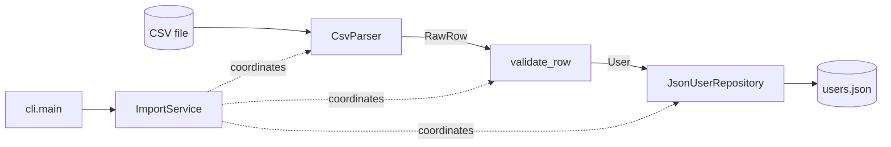

# Resilient Data Importer CLI

A command-line tool that imports users from a CSV file into a JSON file acting as a simple database. Invalid and duplicate rows are skipped and reported, fatal problems stop the import safely, and the database is never left half-written.

## Setup

Requires Python 3.11+.

```bash
git clone https://github.com/<your-username>/resilient-importer.git
cd resilient-importer
python -m venv .venv
.venv\Scripts\activate          # Windows
source .venv/bin/activate       # macOS / Linux
pip install -r requirements.txt
pre-commit install
```

> **Keep the virtual environment activated when committing.** The mypy hook runs the `mypy` installed in the virtual environment, so it fails with "mypy not found" otherwise.
>
> **Windows:** if mypy is blocked with `WinError 4551`, install its pure-Python build:
> `pip uninstall mypy -y` then `pip install --no-binary mypy mypy==1.11.2`

## Usage

```
python -m importer <csv_file> [--db DB] [--log-file LOG_FILE]
```

| Argument | Default | Description |
|---|---|---|
| `csv_file` | required | The CSV file to import |
| `--db` | `data/users.json` | The JSON database. Created on the first import |
| `--log-file` | `logs/importer.log` | The audit log. New entries are appended |

Run `python -m importer --help` to see all options.

### Importing a file

```bash
python -m importer data/sample_users.csv
```

```
Imported 2 user(s).
Skipped 3 row(s):
  line 4: name is empty
  line 5: User with id '1' already exists
  line 6: invalid email 'not-an-email'
```

Running the same import again imports 0 users and skips all 5 rows, because the valid users are already stored. The database is not rewritten, so repeating an import is safe.

### A missing file

```bash
python -m importer data/missing.csv
```

```
Error: File not found: data/missing.csv
```

## CSV format

The header must be exactly `user_id,name,email`. Each row is cleaned, then checked:

- It must have exactly 3 values
- No value may be empty (a value of only spaces counts as empty)
- The email must have a basic valid shape (`name@domain.tld`)
- The `user_id` must not already be stored or appear earlier in the file

Names have extra spaces removed and emails are lowercased before storing. Blank lines are ignored. The file must be UTF-8.

## Error handling

| Situation | Exception | Behaviour | Exit code |
|---|---|---|---|
| CSV file does not exist | `MissingFileError` | Import stops | 1 |
| Empty file, wrong header, or not UTF-8 | `FileFormatError` | Import stops | 1 |
| Database unreadable, corrupted, or cannot be saved | `StorageError` | Import stops, database unchanged | 1 |
| Missing or invalid values in a row | `ValidationError` | Row skipped and reported | 0 |
| `user_id` already exists | `DuplicateUserError` | Row skipped and reported | 0 |
| Wrong command-line usage | | Usage message shown | 2 |

All exceptions inherit from `ImporterError`. Exit code `0` means the import completed, even with skipped rows; `1` means it did not happen.

## Architecture



| Component | Responsibility |
|---|---|
| `CsvParser` | Reads the file and checks it as a whole: exists, UTF-8, correct header |
| `validate_row` | Turns one raw row into a `User`, or raises `ValidationError` |
| `formatters` | Clean names and emails; format the report for the terminal |
| `UserRepository` | Abstract storage interface: `add`, `list_all`, `save` |
| `JsonUserRepository` | Stores users in JSON and rejects duplicate IDs |
| `atomic_write` | Context manager that replaces a file completely or not at all |
| `ImportService` | Runs an import, deciding for each row whether it is imported or skipped |
| `cli.main` | Parses arguments, creates the components, prints the result |

`ImportService` receives its parser and repository instead of creating them, and depends on the abstract `UserRepository`. The real objects are created only in `cli.main`, which lets the service be tested with mocks and lets new storage be added without changing it.

### State consistency

- Existing users are loaded once, new users are kept in memory, and everything is written in a single save at the end.
- The save writes to a temporary file that then replaces the database in one step. If anything fails, the old database stays intact.
- The report is created only after a successful save, so it never claims users that were not stored.

## Logging

Every action is recorded in `logs/importer.log` in a `key=value` format:

```
2026-10-15 17:10:34,847 level=INFO logger=importer.services.import_service row accepted line=2 user_id=1
2026-10-15 17:10:34,847 level=WARNING logger=importer.services.import_service row skipped line=4 reason=name is empty
```

`INFO` records normal progress, `WARNING` a skipped row, and `ERROR` a failed import. Users are identified by `user_id` only; emails are not logged.

## Testing

```bash
python -m pytest                                           # run the tests
python -m pytest --cov --cov-report=term-missing --cov-report=html   # with coverage
```

The HTML report is written to `htmlcov/index.html`, and the latest text report is in [`docs/coverage-report.txt`](docs/coverage-report.txt). A minimum of 90% is enforced in `pyproject.toml`.

**Coverage: 98% across 91 tests.** The only uncovered file is `importer/__main__.py`, which is tested by running `python -m importer` in a separate process that coverage does not measure.

The suite contains unit tests for each component, service tests with mocked dependencies, integration tests using real files, and CLI tests for output and exit codes. Failure cases are covered as thoroughly as success: bad headers, invalid rows, duplicates, corrupted databases, and simulated save failures, including checks that the database is unchanged afterwards.

Code quality is enforced on every commit by pre-commit hooks running Black, ruff (including Google-style docstring checks) and mypy in strict mode. Run them manually with `pre-commit run --all-files`.

## Git workflow

The project follows Git Flow:

- `main`: released code only, updated through release pull requests and tagged (`v1.0.0`)
- `develop`: integration branch for finished features (the default branch)
- `feature/*`: one branch per feature, merged into `develop` through a pull request
- `release/*`: prepares a release from `develop` for merging into `main`

Every pull request uses the template in `.github/pull_request_template.md` and is merged with a merge commit, so each feature branch stays visible in `git log --oneline --graph --all`.